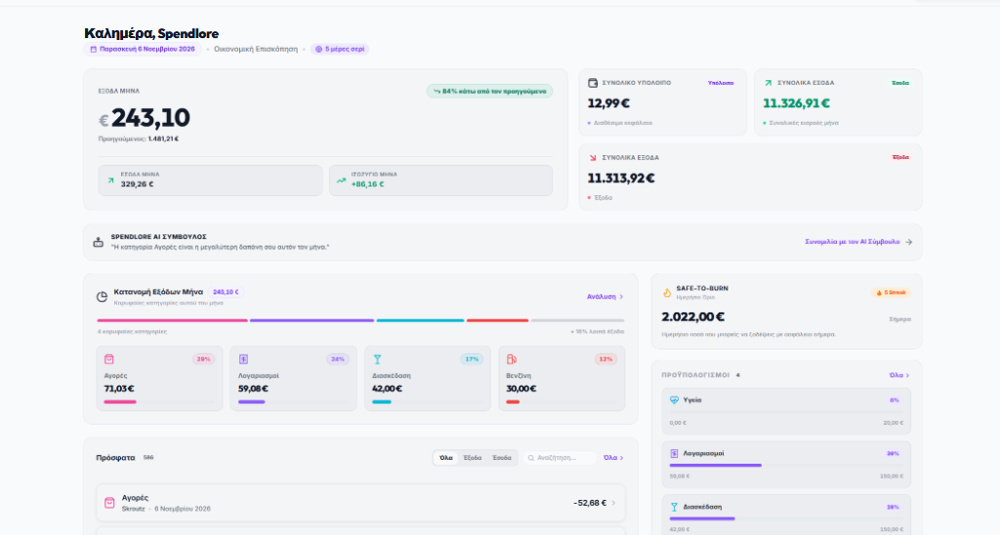
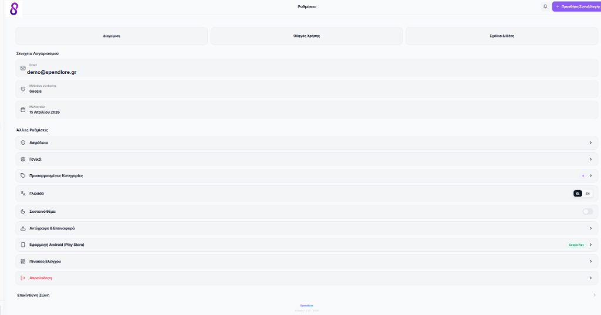
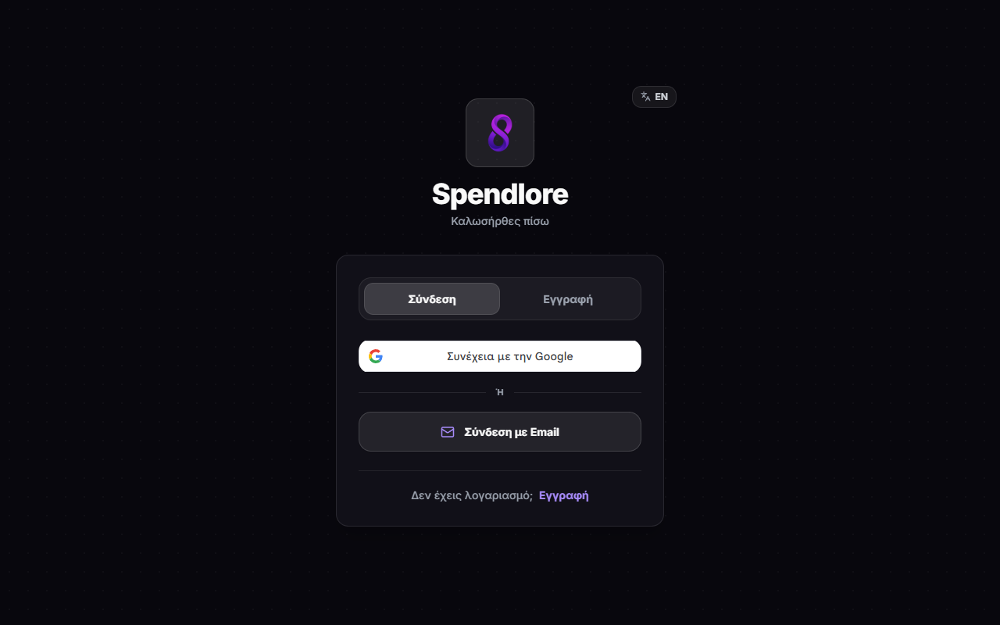
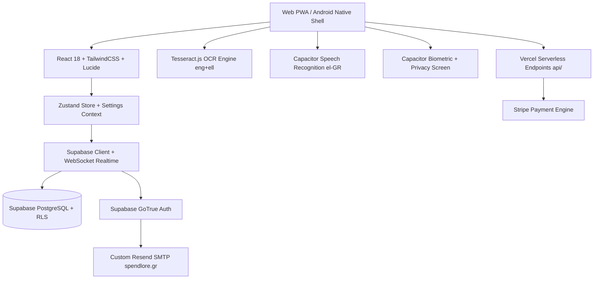

<div align="center">

  

  # Spendlore
  **Master your money with absolute clarity, intelligent automation, and zero friction.**

  [](android/app/build.gradle)
  [](src/utils/__tests__)
  [](https://react.dev/)
  [](https://vitejs.dev/)
  [](https://tailwindcss.com/)
  [](https://capacitorjs.com/)
  [](https://supabase.com/)
  [](https://stripe.com/)
  [](https://app.spendlore.gr)

  <br />

  [Live Web App](https://app.spendlore.gr) &bull; [Marketing Site](https://spendlore.gr) &bull; [Google Play Store](https://play.google.com/store/apps/details?id=com.bomponis.spendwise)

</div>

---

## 📖 Executive Overview

**Spendlore** is an executive-grade personal finance application engineered as a Single Source of Truth for Web (Progressive Web App) and Android Native. Built on React 18, Vite, Tailwind CSS, Capacitor, and Supabase, Spendlore departs from tedious manual bookkeeping by introducing zero-friction data capture, dynamic behavioral spending allowances, and rigorous device-level privacy.

Whether tracking daily coffee purchases via voice in Greek, digitizing multi-item merchant receipts with on-device OCR, or projecting monthly cash flows against recurring liabilities, Spendlore delivers financial serenity through modern corporate engineering standards.

<br />

<div align="center">
  
  <p><em>Executive Financial Overview: Real-time liquid capital, month balance trajectory, dynamic Safe-to-Burn limit, and category velocity analytics.</em></p>
</div>

---

## 🌟 Key Highlights & Differentiating Features

### 1. 🧠 Dynamic "Safe-to-Burn" (STB) Engine
Unlike static budget trackers that leave users guessing whether they can afford a purchase, the **Safe-to-Burn** algorithm calculates an adaptive daily discretionary spending limit:
* Factors in verified current-month income, fixed recurring bills, active savings goal allocations, and day-of-the-month velocity.
* Automatically caps at available liquid balance to prevent overdrafts.
* Features streak tracking and immediate visual status indicators (Safe, Warning, Depleted).

### 2. 📷 Dual-Engine On-Device OCR Scanner
* Real-time receipt scanning powered by `tesseract.js` with integrated Greek (`ell`) and English (`eng`) language packs.
* Client-side interactive image cropping (`react-image-crop`) to isolate receipt totals and line items without sending sensitive receipts to third-party cloud models.
* Includes both Single Receipt Scanner and **Bulk Batch Scanner** modes with automatic total, date, and merchant extraction.

### 3. 🎙️ Natural Voice Recognition
* Instant hands-free transaction logging powered by `@capacitor-community/speech-recognition` on mobile with seamless HTML5 Web Speech API fallback on browsers.
* Configured natively for Greek speech recognition (`el-GR`).
* Automated heuristic keyword parser maps colloquial voice inputs directly into structured categories (e.g., *"50 ευρώ στο σούπερ μάρκετ"* &rarr; `Amount: €50.00`, `Category: Σούπερ Μάρκετ`).

### 4. 🛡️ Multi-Tier Privacy & Defense-in-Depth
* **Native Biometrics & WebAuthn**: Secure app unlock via Face ID, Fingerprint, or WebAuthn hardware credentials (`@capgo/capacitor-native-biometric`).
* **App Switcher Privacy Screen**: Masks the application interface in the Android and iOS app switchers with `@capacitor/privacy-screen` to protect balances from shoulder-surfing.
* **One-Click Privacy Mask**: Instant visual blur over all sensitive monetary amounts across the UI.
* **Row-Level Security (RLS)**: Strict PostgreSQL security policies isolate each user's financial ledger at the database engine level.
* **Active Session Telemetry**: Device auditing with IP geolocation and one-click remote session termination.

### 5. 🎯 Smart Budgets & Goal Forecasting
* Category-specific monthly budget caps with proactive notification warnings at 80% and 100% consumption.
* Savings goals with progress visualization, target dates, and automated contribution logging.

### 6. 💬 Spendlore AI Financial Advisor
* In-app intelligent financial advisor contextualizing spending trends, flagging impulsive expense categories, and proposing high-impact savings recommendations.

### 7. 💳 Monetization & Stripe Pro Subscriptions
* Full subscription lifecycle managed via Vercel Serverless Functions (`/api/create-checkout-session` and `/api/stripe-webhook`).
* Features Pro tiers for unlimited OCR receipt processing, advanced data export (JSON/CSV), and premium priority advisor insights.

### 8. 🎨 Anti-Slop Executive Design System
* Zero visual AI slop: flat high-contrast surfaces, crisp 1px borders, unboxed typography-driven category overlines, and pure Lucide vector iconography.
* Multi-theme modal system supporting **System Default** (live OS listener), **Light Mode**, and **Dark Luxury Obsidian** (`#08070d`).
* Complete bilingual support for **Greek** (`el`) and **English** (`en`).

---

## 📸 Visual Showcase & Interface Design

| **Executive Financial Overview** | **Public Landing & Web Portal** |
| :---: | :---: |
|  |  |
| **Real-Time Wealth & Velocity Tracking**<br>Interactive month balance, adaptive Safe-to-Burn limit, category spend distribution, and real-time ledger. | **Zero-Friction Public Entry**<br>High-converting marketing surface highlighting key value propositions and direct Google Play / PWA links. |

| **Centralized Profile & Settings** | **Obsidian Authentication & Security** |
| :---: | :---: |
|  |  |
| **Modular Settings Categories**<br>App Preferences, Security & Data, System & App, and Session controls with quick theme and language selectors. | **High-Contrast Security Modals**<br>Obsidian dark theme auth surfaces, biometric unlock credentials, and Go-template password recovery. |

---

## 🏗️ Architecture & Technology Stack



| Layer | Technology | Details |
| :--- | :--- | :--- |
| **Frontend Framework** | React 18.3, Vite 4.5 | Fast HMR, code splitting, optimized chunking |
| **Styling & Motion** | Tailwind CSS 3.4, Framer Motion | Strict mobile-first styling, spring physics |
| **State Management** | Zustand, React Context | Persistent cross-tab sync (`spendwise-store`) |
| **Native Runtime** | Capacitor 8 | Native Android wrapper, plugin ecosystem |
| **Database & Auth** | Supabase (PostgreSQL 15) | Realtime subscriptions, Row-Level Security |
| **Custom SMTP** | Resend SMTP (`smtp.resend.com`) | DKIM/SPF authenticated transactional emails |
| **Serverless Backend**| Node.js on Vercel | Stripe webhooks, checkout sessions |
| **Local ML & Voice** | Tesseract.js, Web Speech API | Dual Greek/English OCR, Greek voice capture |
| **Testing Suite** | Vitest, Testing Library | 142 passing integration & unit tests |
| **Observability** | Sentry Browser SDK | Real-time error monitoring and performance |

---

## 📁 Repository Structure

```text
MyFinancesApp/
├── api/                           # Vercel serverless function endpoints (Stripe checkout & webhooks)
│   ├── create-checkout-session.js
│   ├── stripe-webhook.js
│   └── test.js
├── android/                       # Capacitor Android native project & Gradle build scripts
│   ├── app/
│   │   ├── build.gradle           # Native versioning (versionCode, versionName)
│   │   └── src/main/assets/public # Synchronized production web assets
├── public/                        # Static assets, PWA manifests, icons, robots, and sitemap
│   ├── favicon.ico
│   ├── pwa-512x512.png
│   ├── spendlore-mark.png
│   └── manifest.webmanifest
├── scripts/                       # Maintenance, brand asset generators, and Capacitor patching
│   ├── generate-brand-assets.cjs
│   └── patch-capacitor.cjs
├── src/
│   ├── components/                # Reusable UI components, modals, overlays, navigation
│   │   ├── admin/                 # Administrator console widgets and telemetry
│   │   ├── GlobalOverlays.jsx     # App-level modals (Password, Upgrades, Notifications)
│   │   ├── Navbar.jsx             # Adaptive mobile bottom-nav and desktop header
│   │   ├── ThemeSelectionModal.jsx# 3-option theme selector (System, Light, Dark)
│   │   └── __tests__/             # Component-level Vitest unit test specs
│   ├── contexts/                  # React Contexts (Settings, Notifications, Subscriptions)
│   ├── hooks/                     # Custom hooks (Legacy navigation, biometrics)
│   ├── store/                     # Zustand central financial state store (useAppStore.js)
│   ├── utils/                     # Algorithmic engines (Safe-to-Burn, OCR, voice parser, version)
│   ├── views/                     # Top-level screen views (Home, History, Stats, Budgets, Goals, etc.)
│   ├── App.jsx                    # Root application router and auth listener
│   └── main.jsx                   # Vite entry point and Sentry initialization
├── supabase/                      # Database migrations, RLS scripts, and Go email templates
│   ├── templates/
│   │   └── recovery.html          # Go-template compliant executive password reset email
│   └── migrations/                # Database schema and RLS policies
└── vite.config.js                 # Vite bundler configuration & PWA service worker settings
```

---

## 🚀 Getting Started

### Prerequisites

Ensure the following tools are installed on your machine:
* **Node.js**: `v18.0.0` or higher (LTS recommended)
* **npm**: `v9.0.0` or higher
* **Java Development Kit (JDK)**: `v17` or higher (for Android builds)
* **Android Studio & SDK**: API level 34+ (for Android builds)

### Installation

1. **Clone the repository**:
   ```bash
   git clone https://github.com/vaggelis-bomponis/Spendlore.git
   cd Spendlore
   ```

2. **Install project dependencies**:
   ```bash
   npm install
   ```

3. **Configure Environment Variables**:
   Create a `.env` file in the project root:
   ```env
   # Supabase Configuration
   VITE_SUPABASE_URL=https://<your-project-ref>.supabase.co
   VITE_SUPABASE_ANON_KEY=<your-supabase-anon-key>

   # Stripe Monetization
   VITE_STRIPE_PUBLISHABLE_KEY=pk_test_...
   STRIPE_SECRET_KEY=sk_test_...
   STRIPE_WEBHOOK_SECRET=whsec_...
   STRIPE_PRICE_MONTHLY=price_...
   STRIPE_PRICE_YEARLY=price_...

   # Application URLs
   VITE_APP_URL=http://localhost:5173
   VITE_SITE_URL=http://localhost:5173

   # Observability (Optional)
   VITE_SENTRY_DSN=https://...
   ```

### Development Server

Launch the Vite local development server with Hot Module Replacement (HMR):
```bash
npm run dev
```
Open [http://localhost:5173](http://localhost:5173) in your browser.

---

## 🧪 Testing & Verification

Spendlore maintains an extensive automated test suite covering state calculations, modal lifecycles, parser accuracy, and translation dictionaries:

```bash
# Run the complete test suite once
npx vitest run

# Run tests in interactive watch mode
npm test

# Generate test coverage report
npx vitest run --coverage
```

All 142 tests execute against JSDOM with isolated state reset hooks.

---

## 📱 Mobile Workflow (Android & Capacitor)

Spendlore uses a synchronized build pipeline that bundles the web application and injects it directly into the native Android shell:

### 1. Build and Sync Native Assets
```bash
npm run prepare-mobile
```
*Compiles the production Vite bundle, runs `npx cap sync`, and executes custom Cordova/Capacitor compatibility patches.*

### 2. Open Native Android Project
```bash
npx cap open android
```
Opens the `android/` directory in **Android Studio** for compilation, debugging on physical devices, or generating signed APKs/AABs for the Google Play Store.

### 3. Generate Mobile Brand Assets (Optional)
```bash
npx @capacitor/assets generate --android
```

---

## 🔒 Security Best Practices & Policies

* **Zero Plaintext Storage**: Financial figures and transactions are strictly decrypted in-memory and synchronized via secure HTTPS/WSS channels.
* **Row-Level Security (RLS)**: Enforced on all Supabase tables (`transactions`, `categories`, `budgets`, `goals`, `user_profiles`). Direct client requests without a valid user JWT token return empty datasets.
* **Biometric Authentication**: Biometric keys are validated through native device keystores (Android Keystore / iOS Keychain).
* **Controlled Git Discipline**: All releases follow the Conventional Commits specification. Remote pushes are strictly reserved for manual developer audit.

---

## 📄 License & Attribution

This project is licensed under the **MIT License** — see the [LICENSE](LICENSE) file for details.

Developed with passion by **Vaggelis Bomponis**.  
&copy; 2026 Spendlore. All rights reserved.
